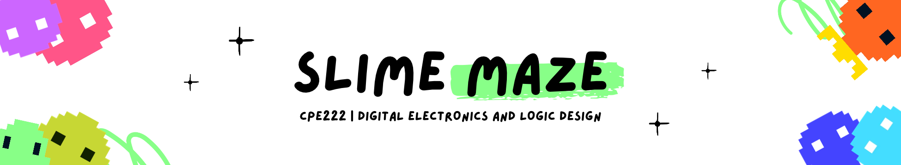
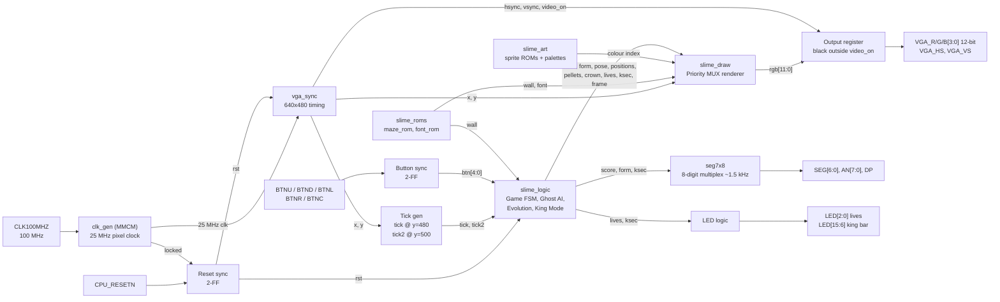
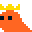

<div align="center">



# SLIME MAZE

**CPE222 | DIGITAL ELECTRONICS AND LOGIC DESIGN**
\
**เกมอาร์เคดเขาวงกตบน FPGA (VGA 640×480 @ 60 Hz) — Final Project**


</div>

---

## ภาพรวมโปรเจกต์

**SLIME MAZE** เป็นเกมอาร์เคดแนวเขาวงกตที่พัฒนาด้วย Verilog HDL สำหรับบอร์ด **Nexys A7-100T (`xc7a100tcsg324-1`)** แสดงผลผ่านพอร์ต VGA ความละเอียด `640×480` (ตาราง `20×15` ช่อง ช่องละ `32×32` พิกเซล) ที่ 60 เฟรมต่อวินาที พร้อมระบบจำลองการเล่นบนเครื่องคอมพิวเตอร์ด้วย **Verilator + SDL2**

### สถาปัตยกรรมระบบ



---

## วิธีเล่นและระบบเกม

### 1. การวิวัฒนาการของสไลม์ (Evolution)

| ร่าง (Form) | เงื่อนไขการเปลี่ยนร่าง | ความสามารถพิเศษ |
| :---: | :--- | :--- |
|**Form 1** (Small Slime)| เริ่มต้นเกม | เดินเก็บเม็ด (`+10` คะแนน/เม็ด) หลบผีทั้ง 4 ตัว |
|**Form 2** (Big Slime)| เก็บเม็ดครบ **30 เม็ด** (`N_EVOLVE`) | มงกุฎจะปรากฏขึ้นในเขาวงกต |
|**Form 3** (King Mode)| เก็บ **มงกุฎ** ในร่าง 2 | เดินเร็ว **2 เท่า** และกินผีได้ (`+200` คะแนน/ตัว) นาน **10 วินาที** |

- เมื่อหมดเวลา King Mode (ใน 2 วินาทีสุดท้ายตัวละครและผีจะกะพริบเตือน) สไลม์จะกลับเป็น **Form 2** และมงกุฎจะโผล่ใหม่ใน **3 วินาที** (`CROWN_DELAY = 180` เฟรม)
- **ชนะ (WIN)**: กินผีครบทั้ง 4 ตัว
- **แพ้ (GAME OVER)**: โดนผีจับครบ 3 ชีวิต

### 2. การควบคุมและการแสดงผลบนบอร์ด Nexys A7-100T

| อุปกรณ์บนบอร์ด | หน้าที่ |
| :--- | :--- |
| `BTNU` / `BTND` / `BTNL` / `BTNR` | บังคับทิศทางเดิน (กดเลี้ยวล่วงหน้าก่อนถึงทางแยกได้) |
| `BTNC` | เริ่มเกม / หยุดเกมชั่วคราว (Pause) / กลับหน้า Title |
| `CPU_RESET` (`CPU_RESETN`) | รีเซ็ตเกมใหม่ทั้งหมด |
| **7-Segment 8 หลัก** | หลักขวา 4 หลัก = คะแนน, หลัก 5–4 = เวลาร่าง 3 (วินาที), หลักซ้ายสุด = ร่างปัจจุบัน (`1`–`3`) |
| **LEDs** | `LD2`–`LD0` = ชีวิตที่เหลือ, `LD15`–`LD6` = แถบเวลา King Mode (10 ดวง) |

---

## โครงสร้างไฟล์

```text
slime_maze/
├── slime_top.v          # Top module สำหรับบอร์ด Nexys A7-100T
├── clk_gen.v            # ตัวแปลงสัญญาณนาฬิกา 100 MHz -> 25 MHz (จาก Lab 8)
├── vga_sync.v           # VGA timing generator 640x480 @ 60 Hz (จาก Lab 8 Part A)
├── slime_logic.v        # ตรรกะเกม: FSM, การเดิน, AI ผี, เปลี่ยนร่าง, คะแนน, ชีวิต
├── slime_draw.v         # Priority MUX วาดพิกเซล (ข้อความ > สไลม์ > ผี > มงกุฎ > เม็ด > ไอคอน > กำแพง > พื้น)
├── slime_roms.v         # ROM แบบ combinational: แผนที่เขาวงกต (maze_rom) และฟอนต์
├── slime_art.v          # ROM พาเลตสีและสไปรต์ (สร้างอัตโนมัติจาก gen_art.py)
├── seg7x8.v             # ตัวขับ 7-segment 8 หลัก
├── slime_nexys_a7.xdc   # Pin constraints สำหรับ Nexys A7-100T
├── gen_art.py           # สคริปต์แปลง PNG ใน sprite/ เป็นไฟล์ slime_art.v
├── sprite/              # รูปสไปรต์ PNG ต้นฉบับ (30 ไฟล์)
└── sim/                 # ตัวจำลองเล่นบนเครื่องด้วย Verilator + SDL2
```

---

## การใช้งาน

### วิธี Build ลงบอร์ดจริง (Vivado)

1. สร้างโปรเจกต์ใหม่ใน **Vivado** โดยเลือกบอร์ด **Nexys A7-100T** (`xc7a100tcsg324-1`)
2. **Add Sources**: เพิ่มไฟล์ `.v` ทั้ง 8 ไฟล์ในโฟลเดอร์หลัก (`slime_top.v`, `clk_gen.v`, `vga_sync.v`, `slime_logic.v`, `slime_draw.v`, `slime_roms.v`, `slime_art.v`, `seg7x8.v`)
3. **Add Constraints**: เพิ่มไฟล์ `slime_nexys_a7.xdc`
4. ตั้ง `slime_top` เป็น **Top Module** จากนั้นรัน **Generate Bitstream** และ **Program Device**

### จำลองเล่นบน Mac (โฟลเดอร์ `sim/`)

ตัวจำลองจะคอมไพล์ `slime_logic.v` และ `slime_draw.v` ตัวจริงผ่าน **Verilator** แล้วแสดงผลแบบเรียลไทม์ด้วย **SDL2**

1. **ติดตั้งเครื่องมือ (ทำครั้งเดียว)**:
   ```bash
   xcode-select --install
   brew install verilator sdl2
   ```
2. **รันตัวจำลอง**:
   ```bash
   cd sim
   make run
   ```
   - `make run` — โหมดเร็ว **60 FPS** (ส่งสัญญาณ `tick` ให้เฟรมละครั้ง เหมาะสำหรับเล่นทดสอบ)
   - `make run-exact` — จำลอง `vga_sync` ทีละพิกเซลเหมือนบนบอร์ดจริง (ช้ากว่าเวลาจริงหลายเท่า)

3. **ปุ่มควบคุมในตัวจำลอง**:

| ปุ่มคีย์บอร์ด | เทียบเท่าปุ่มบนบอร์ด | หน้าที่ |
| :---: | :---: | :--- |
| `↑` `↓` `←` `→` | `BTNU` `BTND` `BTNL` `BTNR` | เดิน |
| `Space` หรือ `Enter` | `BTNC` | เริ่มเกม / หยุดชั่วคราว |
| `R` | `CPU_RESET` | รีเซ็ตเกมใหม่ |
| `Esc` | — | ออกจากโปรแกรมจำลอง |

> แถบชื่อหน้าต่างจะแสดงสถานะเกม (`TITLE` / `PLAY` / `PAUSE` / `CAUGHT` / `WIN` / `GAME OVER`), คะแนน, ชีวิต, ร่าง และเวลา King Mode แทน 7-Segment และ LED

---

## การปรับแต่งเกมและสไปรต์

### ปรับพารามิเตอร์เกมและแผนที่

- **ค่าคงที่ใน `slime_logic.v`**: ปรับ `N_EVOLVE` (จำนวนเม็ดเพื่อเปลี่ยนเป็นร่าง 2), `KING_SECONDS` (ระยะเวลาร่าง 3), และ `CROWN_DELAY` (เวลารอเกิดใหม่ของมงกุฎ)
- **แผนที่เขาวงกตใน `slime_roms.v`**: แก้ไขบิตแมป `20×15` ในโมดูล `maze_rom` ได้โดยตรง (ขอบนอกสุดทั้ง 4 ด้านต้องเป็นกำแพง `1` ทั้งหมด)

### เปลี่ยนรูปสไปรต์ (`sprite/`)

รูปทั้งหมดอยู่ในโฟลเดอร์ `sprite/` เป็นไฟล์ PNG ขนาด `32×32` พิกเซล (ยกเว้น `life_alive.png` และ `life_died.png` ขนาด `8×8` ที่ขยาย 2 เท่าตรงมุมซ้ายบน)

- **กลุ่มสไลม์ มงกุฎ เม็ด ไอคอน** (`art_palette`, 5-bit): ใช้สีรวมกันได้ไม่เกิน **31 สี** (ปัจจุบันใช้ 17 สี)
- **กลุ่มผี** (`ghost_0`..`ghost_3`, `ghost_scared` ใน `ghost_palette`, 4-bit): ใช้สีรวมกันได้ไม่เกิน **15 สี** (ปัจจุบันใช้ 6 สี)
- เมื่อแก้ไขรูปเสร็จแล้ว ให้รันคำสั่งสร้างไฟล์ `slime_art.v` ใหม่ (ต้องมี Pillow: `pip3 install pillow`):
  ```bash
  python3 gen_art.py .
  ```

#### ตารางสไปรต์ทั้งหมด (Sprite Gallery)

**สไลม์ทั้ง 3 ร่าง (`32×32`)**

| ร่าง (Form) | Idle | Up | Down | Left | Right | Died |
| :--- | :---: | :---: | :---: | :---: | :---: | :---: |
| **Form 1** (Small) |  |  |  |  |  |  |
| **Form 2** (Big) |  |  |  |  |  |  |
| **Form 3** (King) |  |  |  |  |  |  |

**ผี (`32×32`)**

| Ghost 0 | Ghost 1 | Ghost 2 | Ghost 3 | Scared (King Mode) |
| :---: | :---: | :---: | :---: | :---: |
|  |  |  |  |  |
| `ghost_0.png` | `ghost_1.png` | `ghost_2.png` | `ghost_3.png` | `ghost_scared.png` |

**ไอเทมและไอคอน HUD**

| Pellet (`32×32`) | Crown 0 (`32×32`) | Crown 1 (`32×32`) | Crown 2 (`32×32`) | King Icon (`32×32`) | Life Alive (`8×8`) | Life Died (`8×8`) |
| :---: | :---: | :---: | :---: | :---: | :---: | :---: |
|  |  |  |  |  |  |  |
| `ball.png` | `king0.png` | `king1.png` | `king2.png` | `kingmode.png` | `life_alive.png` | `life_died.png` |

---

## สมาชิกผู้จัดทำ 

-  **กฤษติธี อัศวดิษฐเลิศ** — [](https://github.com/krittitee-ausa)
-  **วรเมธ กิตติโชติรัตน์** — [](https://github.com/EtamaroV)
-  **อรรถเชษฐ์ อนันต์คูศรี** — [](https://github.com/W1nAA)
-  **ปริญญา เส็มเส็น** — [](https://github.com/aynirap)
-  **พัชรพล ธรรมมล** — [](https://github.com/spruc3sap)


